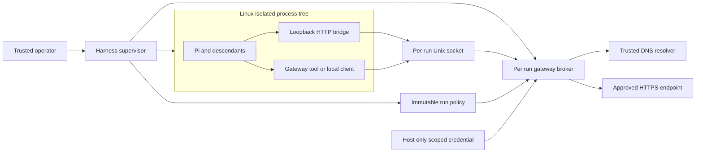

# Harness external access gateway design

Status: accepted for staged implementation, October 11, 2026.

## Recommendation and scope

Build a small harness-owned broker outside an isolated Pi process tree. Pi, its extensions, its tools, and every descendant have no external network interface. They request approved operations through a per-run Unix domain socket. The broker alone performs destination resolution, external connection establishment, TLS verification, credential injection, and decision logging.

Interpret “all network access needs to happen through the harness” as an enforced execution boundary: every successful external operation originating from the managed run is authorized by the harness-owned gateway. A tool hook alone cannot enforce that property. Unsupported operations fail; supporting all network protocols is a separate compatibility objective.

The first release supports one OpenAI-compatible chat completion route with streaming, and an HTTPS fetch capability selecting exact resources configured by the operator. It blocks arbitrary URLs, CONNECT, SOCKS, raw TCP, SSH, UDP, QUIC, external DNS from the sandbox, remote MCP, package installation, and Git networking. Broader fetch rules and service operations require later specification changes. Preinstalled local shell, file tools, and tests remain available.

The enforcement platform is Linux. Development on macOS can use a dedicated Linux VM. A native macOS implementation needs its own design and bypass suite; its guarantee must not be inferred from Linux results. The gateway is lightweight; the VM needed on this workstation has a separate resource cost.

## Security foundation

The design follows complete mediation, fail-safe defaults, least privilege, and economy of mechanism from [Saltzer and Schroeder](https://web.mit.edu/Saltzer/www/publications/protection/). Their application here is a design inference: constrain the execution environment as well as the gateway API, and make permission checks mandatory before network effects.

Two controls have distinct jobs. OS isolation prevents bypass; semantic authorization limits what the broker can do on behalf of the run. [GitHub Agentic Workflow Firewall](https://github.github.com/gh-aw-firewall/reference/security-architecture/) explicitly documents why hostname policy cannot enforce repository identity or prevent data being sent to approved destinations. Its limitation motivates capability routes with fixed operations.

## Architecture

The supervisor provisions one broker per run, then starts a bridge and Pi within the same isolated network namespace. The namespace has loopback as its only usable interface, with no veth, default route, or host networking. Kernel-created tunnel interfaces may exist only down and unaddressed. The bridge binds to 127.0.0.1 and forwards HTTP to the mounted pathname Unix socket. This preserves ordinary Pi provider HTTP behavior without exposing a host TCP listener. The bridge is compatibility machinery, not a policy authority. Direct socket access has exactly the same permissions as bridge access.

The broker has no arbitrary forwarding endpoint. It accepts ordinary origin-form HTTP over the Unix socket, validates each operation, and constructs fresh upstream requests. It never forwards a client-provided destination, Host header, proxy setting, or upstream credential.

### Components and responsibilities

| Component | Responsibility | Authority |
| --- | --- | --- |
| Supervisor | Load operator policy, create run identity and paths, launch isolation, monitor lifecycle, terminate run | Trusted local control; no agent-controlled configuration |
| Linux launcher | Assemble the reviewed bubblewrap profile and process limits | Trusted; must fail if isolation cannot be established |
| Broker | Validate requests, enforce quotas, construct approved requests, perform DNS and TLS, hold credentials, audit | Sole external access authority for the run |
| Loopback bridge | Relay local HTTP over the per-run socket, propagate close/cancel | No upstream credentials, destination selection, or security decisions |
| Pi configuration and optional fetch extension | Point model requests at bridge; expose approved resource IDs | Untrusted for security purposes; pinned for predictable behavior |

Use one Go executable with supervisor, broker, bridge, and local client subcommands, plus the existing bubblewrap launcher. Start with the standard library and narrowly justified Linux support dependencies. No database, policy language interpreter, container orchestrator, TLS interception CA, telemetry service, dynamic plugins in the broker, or public gateway listener. Pi's Node runtime is a fixture dependency rather than part of the gateway binary.

One broker per run simplifies identity, cancellation, pooling, quotas, and policy lifetime. It consumes more aggregate memory than a shared daemon at high concurrency; shared multi-tenant operation is deferred.

## Trust and threat model

Treat model outputs, prompts, fetched documents, workspace contents, Pi itself, installed extensions, and child processes as potentially adversarial. Assume an attacker can execute arbitrary unprivileged code inside the sandbox and can call every exposed broker operation. Do not rely on Pi following instructions.

Trusted: host kernel, VM boundary where used, operator, pinned launcher and gateway, immutable policy, host credential storage, and DNS/TLS implementation. A hostile host administrator, kernel exploit, compromised gateway binary, or upstream service compromise is outside the first release guarantee. This is a local single-operator system, not a hostile multi-user hosting boundary.

| Threat | Required control | Remaining limit |
| --- | --- | --- |
| Shell or extension bypasses tool hook | Entire process tree gets isolated namespaces and constrained mounts | Kernel and launcher remain trusted |
| Host service acts as a network deputy | No host daemon, SSH agent, Docker, D-Bus, resolver, or other host IPC socket mounts; no inherited connected descriptors | Explicit supervisor output handling is still trusted |
| SSRF or DNS rebinding | Fixed resource destinations, validated resolved IPs, dial the validated IP, hostname TLS verification, redirects off | Approved service can itself perform downstream actions |
| Credential theft | Secrets outside agent mounts/env; gateway reconstructs auth; no upstream response body logging | A malicious approved upstream could echo a secret; gateway is not general data-loss prevention |
| Privilege or namespace escape | Drop capabilities, no new privileges, isolated PID/proc/mount/IPC/user/net namespaces, reviewed syscall restrictions | Shared-kernel isolation is not a VM proof |
| Forged run/tool identity | Authority bound to one listener/policy snapshot; reject client identity overrides | Cannot distinguish malicious shell from legitimate Pi tool within a run |
| Resource exhaustion | Bounded bodies, connections, concurrency, deadlines, run request/byte budgets, process limits | Model tokens and financial cost require additional provider-specific controls |
| Gateway failure | No route outside jail; terminate or deny requests; no fallback | Availability suffers when broker or audit fails |
| Prompt injection within permitted call | Fixed routes and scoped credentials limit consequences | Allowed model prompts or fetch access patterns can leak readable data |

The guarantee does not mean source confidentiality. The selected model endpoint necessarily receives prompts; local stdout and exported files are also information channels. A local read-only GET may trigger remote side effects or reveal timing. The operator must trust permitted destinations and mount only data that may be used during the run.

## Linux execution boundary

Reuse [bubblewrap](https://github.com/containers/bubblewrap) rather than implementing namespace setup from scratch. Bubblewrap is a mechanism: the selected arguments and mounts define this project's security boundary. [Anthropic Sandbox Runtime](https://github.com/anthropics/sandbox-runtime) is a useful existing alternative and reference for OS restrictions plus local proxying; adoption would still require a matching profile and independent bypass tests.

The proposed profile has:

1. A separate user, PID, mount, network, IPC, and UTS namespace. The namespace contains no external interfaces or routes; abstract Unix sockets are separated by the network namespace.
2. A minimal read-only runtime filesystem assembled from pinned artifacts, private tmpfs home/tmp, read-only Pi configuration, and only the designated writable workspace. No broad host root or home bind mount.
3. A narrow mount exposing the per-run pathname socket from a trusted directory; policy, secrets, audit, other run sockets, and supervisor files remain absent. Reject special files and socket-bearing workspace layouts; workspace export is ordinary file data, not an IPC mount.
4. No ambient/effective capabilities; no_new_privs; reviewed seccomp policy blocking namespace entry, mount changes, ptrace escape paths, and privileged networking. A child may create additional isolated namespaces only if the reviewed profile permits it; it cannot join the host namespace.
5. Closed inherited descriptors except stdin/stdout/stderr used by the supervisor. Inputs are bytes, never an upstream socket or a passed descriptor. No privileged launcher control endpoint is exposed to Pi.
6. Bounded process, file descriptor, CPU, memory, and disk resources. Require suitable cgroup v2 delegation for process-tree CPU/memory/process caps on the release test platform; otherwise refuse the enforced profile.

The supervisor must not execute agent-emitted commands, shell escapes, or URLs outside the jail. Build/provisioning is a trusted preparatory phase; it happens before agent execution and has its own dependencies and network scope. No runtime auto-install or updater exception is allowed.

## Authority and policy

Each run has an opaque random ID, an immutable versioned policy, and a distinct listener in a private host directory. Mount only that listener's socket into the corresponding sandbox. File permissions and mount isolation constrain access; a random path is not sufficient on its own. Other untrusted host users are excluded by the single-operator assumption.

Do not accept a client-selected run ID, policy path, credential reference, upstream URL, or security-relevant tool name. Claimed tool labels can be optional audit metadata later; they never increase permission. The whole run is the principal.

Policy is a finite map of capabilities. A model capability maps a local route to one fixed HTTPS origin/path, a finite model ID set, an exact supported request schema, an upstream secret reference, and budgets. A fetch capability maps an opaque resource ID to one exact HTTPS URL with no agent-controlled query, request body, or headers. The first release can therefore remain small while still proving the authority boundary. Dynamic URL fetch is a follow-up, not an implicit permissive default.

Changing permissions requires a new run. Emergency revocation cancels active broker contexts, stops accepting requests, closes idle connections, and ends the run. It cannot undo bytes already sent or remote actions already committed.

## Request and connection lifecycle

The broker performs these steps in order:

1. Check that the run is active and within its hard lifetime. Parse bounded HTTP and operation input; reject unsupported methods, routes, encodings, or fields.
2. Select the capability from trusted route configuration; validate model/resource and operation parameters. Reserve concurrent and cumulative budgets atomically.
3. Append a bounded allow decision to the host audit sink before DNS or external connection. A sink error prevents a new outbound operation.
4. Resolve only the configured hostname through the trusted resolver. Reject the entire answer if any effective address is not approved public unicast. Apply maintained special-use IPv4/IPv6 ranges and deployment-specific internal ranges; ordinary global-unicast classification is insufficient.
5. Connect to a selected validated literal IP on port 443; do not perform another implicit hostname lookup. Use the configured hostname for SNI, Host, and certificate verification. Environment proxies are disabled. TLS certificate validation remains enabled.
6. Construct fresh allowed headers, inject the selected upstream credential, and send the validated body. Redirects and automatic request replay are disabled.
7. Stream a bounded response with backpressure. Propagate client cancellation, run revocation, deadlines, and byte limits to the upstream context and connection. Log completion metadata and release in-flight reservations exactly once.

Follow [OWASP SSRF guidance](https://cheatsheetseries.owasp.org/cheatsheets/Server_Side_Request_Forgery_Prevention_Cheat_Sheet.html) for defense at both application and network boundaries. The exact URL grammar and special-use range rules are specified in the coding contract. DNS is not agent-controlled: denial tests must verify that rejected requests cause neither target DNS queries nor target connections.

For simplicity, upstream HTTP/1.1 uses a fresh connection per operation in the first release, without redirects, cross-route pools, response decompression, or retries. This makes connection authorization and DNS pinning easier to inspect, at the cost of DNS/TLS latency. Connection pooling can be added only with tests proving route, credential, and policy separation. Streaming is essential to usable model interaction and remains in scope.

## Pi integration

Use [Pi](https://github.com/earendil-works/pi) as a small open-source fixture. The historical badlogic/pi-mono repository currently redirects there. Pin an exact release or commit and package integrity before implementation. Its [security guidance](https://github.com/earendil-works/pi/blob/main/packages/coding-agent/docs/security.md) leaves process, network, filesystem, and credential restrictions to the runtime environment.

Configure the existing compatible provider through [models.json](https://github.com/earendil-works/pi/blob/main/packages/coding-agent/docs/models.md), with baseUrl pointing at the namespace-local bridge. Keep provider protocol conversion out of the gateway. The fixture uses a literal dummy client key; the socket's run authority, rather than this dummy value, authorizes broker requests. Never forward it upstream. Disable executable credential configuration and ambient provider authentication sources.

Use one-shot JSON mode with a fresh isolated agent directory and explicit model/tools. From the [CLI contract](https://github.com/earendil-works/pi/blob/main/packages/coding-agent/docs/cli.md), verify at the pinned version the offline and resource-disabling switches, including --no-extensions, --no-mcp, --no-skills, --no-prompt-templates, --no-context-files, and --no-session. Explicitly loaded test extensions may still run. Offline mode reduces background activity; namespace isolation enforces network denial.

A small explicit extension exposes fetch(resource_id) if needed. Shell children can invoke a local gateway client with the same capability set. Native curl to the Internet fails even with an approved hostname; adapting network clients is deliberate. Test malicious extensions with the same OS restriction. Do not claim trustworthy per-tool attribution from Pi extension callbacks.

## Alternatives and tradeoffs

| Option | Advantages | Costs and weaknesses | Decision |
| --- | --- | --- | --- |
| Pi hook and environment proxy only | Very small integration; familiar network clients | Bypassable by subprocesses, extensions, direct sockets, and DNS | Insufficient for the stated guarantee |
| General CONNECT/SOCKS gateway with hostname rules | Broad HTTPS/TCP compatibility | Cannot reliably authorize encrypted operations or inject scoped credentials without more machinery | Defer |
| Full TLS interception proxy | Can inspect normal HTTPS clients | Trusted CA distribution, TLS complexity, sensitive plaintext exposure, compatibility failures | Exclude from first release |
| Existing agentgateway or MCP gateway | Rich routing, protocol handling, authentication and policy features | Still needs isolation; larger configuration/feature surface than the proposed local scope | Reconsider when MCP/fleet needs justify it |
| Existing sandbox runtime plus custom broker | Faster reuse of platform support | Must verify profiles; broader runtime dependency and moving interfaces | Viable fallback if direct bubblewrap profile proves costly |
| Small Go broker plus Linux isolation | Few services, inspectable authority, secrets outside agent, deterministic policy | Less network compatibility, Linux setup, per-run process overhead, own broker maintenance | Recommended first release |
| Dedicated VM per run | Stronger separation from host kernel and other workloads | Higher startup and memory cost | Use where risk warrants; Mac test environment needs a Linux VM anyway |

The lightweight budgets are measured in the implementation evidence; results depend on the reference environment. The proposed budgets are a binary at most 20 MiB, incremental idle gateway/supervisor/bridge memory at most 64 MiB per run, and at most 10 ms p95 local mediation overhead with a warmed deterministic upstream fixture. These exclude Pi, the VM, remote latency, and necessary DNS/TLS connection cost, which must be reported separately. Security gates cannot be waived to meet these targets.

## Decisions and limits for review

The recommended decisions are Linux enforcement first, a standard-library-oriented Go implementation, bubblewrap reuse, per-run authority, fixed capabilities, one model protocol, no transparent tunnels, no runtime policy changes, no retries, and no service writes. These decisions keep the trusted implementation small and the tests specific.

Before building, freeze the Pi artifact, exact provider request fields, supported Linux/kernel/launcher profile, deployment private address ranges, fetch resources, and performance reference host. The next phase should validate the network boundary and Pi protocol compatibility before expanding functionality. The coding spec and staged plan define the required evidence.
